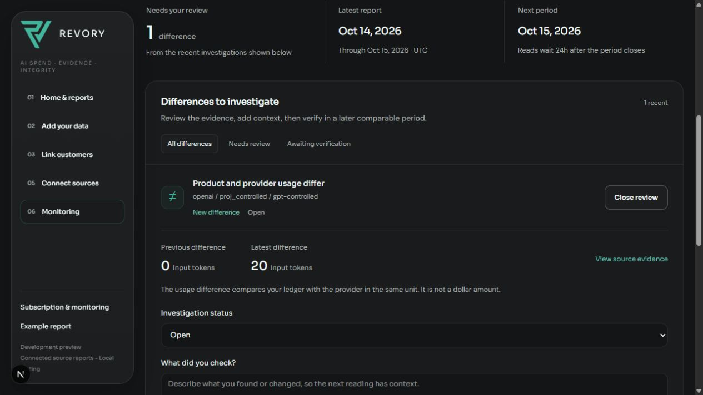
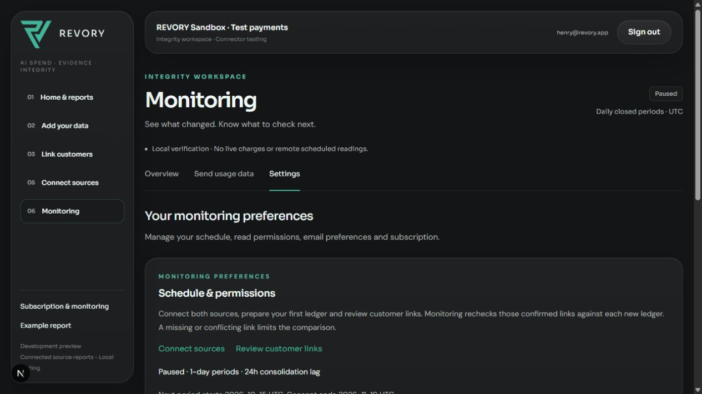

# Monitor US$399 — homologação técnica de 20/10/2026

## Decisão

**Cobrança em sandbox e conexões reais com contas vazias: verificadas.** A homologação técnica completa e a ativação comercial continuam pendentes dos itens abaixo. Zero cobranças live, compradores reais ou renovações comerciais nesta prova.

O aplicativo executou em `localhost:3160`, com banco Postgres local descartável, 37 migrations e role de runtime sem propriedade de tabelas. A conta local `henry@revory.app` é uma identidade de QA; não houve alteração de senha ou sessão de produção. Stripe CLI encaminhou os webhooks assinados ao endpoint real do aplicativo. Nenhum endpoint de webhook remoto foi criado.

## Evidências

| Percurso | Resultado | Registro |
| --- | --- | --- |
| App → Checkout hospedado → cartão de teste → webhook → acesso | PASS; invoice de USD39900 paga; uma assinatura; nenhum grant avulso | [Checkout](stripe-checkout.json) |
| Renovação da mesma assinatura pelo test clock | PASS; nova invoice paga, período atualizado pelo webhook | [Renovação](stripe-renewal.json) |
| Cartão de teste recusado → mesma invoice paga depois | PASS; `PAST_DUE` bloqueia, recuperação retorna a `ACTIVE` | [Falha e recuperação](stripe-failure-recovery.json) |
| Cancelamento pelo portal dedicado e término natural | PASS; acesso preservado durante período pago, `CANCELED` no término | [Cancelamento/refund](stripe-cancellation-refund.json) |
| Refund de fundos fictícios e replay de evento ativo antigo | PASS; `BLOCKED` permanece após dois replays | [Cancelamento/refund](stripe-cancellation-refund.json) |
| Assinatura acima → ledger CSV/API → quatro relatórios | PASS; transportes de fonte **controlados/injetados**, movimentos novo/persistente/não observado/novo; não são leituras reais de uso | [Relatórios](paid-workspace-report.json) |
| Restricted key Stripe → GET identidade + invoices da janela | PASS; transporte real e chave criptografada pelo app; sandbox sem linhas, promoção bloqueada | [Fonte Stripe](stripe-source.json) |
| Admin key OpenAI restrita → GET Usage + Costs da janela | PASS; transporte real, dois canais sem linhas, promoção bloqueada; nenhuma geração ou compra de créditos | [Fonte OpenAI](openai-source.json) |
| Revogação das duas chaves temporárias | PASS; ambas retornaram HTTP401 após revogação; envelopes de credenciais removidos do app | Registros de fontes acima |
| Avisos, deduplicação e limites | PASS no harness com sender controlado; **entrega real Resend não demonstrada** | [Motor local](../recurring-monitor/core-proof.json) |
| Agendador remoto | Cliente e guards testados; workflow preparado, **não ativado** | `scripts/validate-monitor-dispatch.mjs` |

As contas de fonte Stripe e de cobrança do REVORY são independentes. O sandbox de fonte aberto pelo fundador era “Área restrita de New business”. A organização OpenAI pessoal não possui dados nessa janela. Isso comprova autenticação, permissão, leitura, persistência e tratamento conservador de vazio; não comprova equivalência CSV/API com dados reais não vazios.

## Correções encontradas no teste

1. Expiração de Checkout de 30 minutos era recusada pelo Stripe após latência. A janela agora é uma hora, com teste de margem.
2. Recarregar a tela mudava a request key e impedia recuperar Checkout pendente. O mesmo proprietário agora reutiliza a sessão válida, sem segunda assinatura.
3. O portal precisa de configuração `bpc_` dedicada, verificada no servidor, sem troca para planos históricos/incompatíveis.
4. O portal real pode preencher `cancel_at` mantendo `cancel_at_period_end=false`. O app preserva essa data, limita o acesso em cache e mostra que a assinatura não renovará. O teste também cobre cancelamento anterior ao fim do período.
5. Cron de cinco minutos é incompatível com Vercel Hobby. Foi retirado de `vercel.json`; o workflow GitHub preparado fica desligado até configuração e ativação aprovadas. Não há SLA de cinco minutos.

O primeiro GET local da OpenAI encontrou `SELF_SIGNED_CERT_IN_CHAIN`. A leitura passou com Node `--use-system-ca`, usando autoridades já confiáveis no Windows. A validação TLS permaneceu ativa. Não se alterou o transport do produto nem se aplicou bypass de certificado.

## Verificação reproduzível sem credenciais externas

- `npm run qa:ai-monitor:db`, com Postgres local preparado: PASS após as correções; migrations, concorrência, identidade/consentimento, token, períodos, investigação, notices, Checkout/portal, cancelamento datado e refund/replay.
- `REVORY_MONITOR_QA_BROWSER=true npm run qa:ai-monitor:db`: PASS no percurso anterior desta sessão; desktop/mobile, origem, ingestão HTTP e revogação. A mensagem nova de cancelamento datado foi verificada manualmente no navegador real.
- `node scripts/validate-monitor-dispatch.mjs`: PASS; destino permitido, ausência de envio de credencial a destinos rejeitados, redirects recusados, runtime desabilitado e HTTP401.
- TypeScript `--noEmit` e ESLint dos arquivos afetados: PASS.

Para repetir os testes reais: usar banco local descartável e credenciais test; criar Product/Price/portal próprios com metadata de QA; pagar Checkout com cartão de teste; encaminhar eventos assinados pelo Stripe CLI; avançar o test clock da mesma conta/assinatura. Esperar `ready` após anexar e avançar o clock. Para fontes, criar chaves temporárias mínimas, confirmar a identidade e janela UTC fechada, ler através do cofre do app e revogar ao terminar. Nunca copiar secrets para o relatório.

## Recursos após o teste

- As duas chaves temporárias de fonte foram revogadas no provedor e removidas do armazenamento de credenciais do aplicativo.
- Assinatura de teste encerrada; Price/Product arquivados, configuração de portal desativada e test clock/cliente de QA removidos. Os demais produtos, preços e chaves da conta foram preservados.
- Evidências locais não são grants gratuitos ou análises de clientes. A agenda local foi pausada antes de substituir as fontes controladas pelas fontes reais.
- Sem deploy, mudanças em produção, domínio, OAuth, Resend ou ativação de jobs externos nesta homologação.

## Pendências verificáveis

1. **Fontes reais não vazias e equivalência:** ledger autorizado do mesmo período e conta, identidade revisada e comparação entre API/CSV. A conta vazia não supre essa evidência; tampouco é necessário gerar consumo artificial para isso.
2. **Resend real:** verificar um aviso de homologação até entrega no destinatário autorizado. A chave existente é sensível no Vercel e não estava disponível no processo local; não foi copiada nem enfraquecida para o teste. O sender controlado não conta como entrega real.
3. **Ambiente remoto:** preparar alvo/banco comercial de homologação separado da demo, webhook alcançável e segredos próprios; testar fluxo remoto. O encaminhamento CLI local não comprova entrega de webhook num Preview protegido.
4. **Agendamento remoto:** configurar o dispatcher no alvo aprovado e observar a primeira execução natural. Workflow presente não significa agendamento ativo.
5. **Validação comercial:** cliente real consentido, valor percebido e renovação. Test clock e pagamentos de teste não contam como compradores.

## Tela da prova

